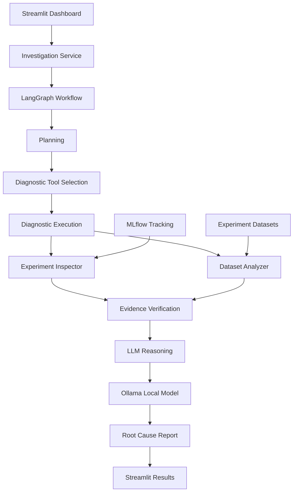

# MIRA
### ML Investigation & Root-Cause Analysis Agent

MIRA is a local AI-powered investigation platform designed to analyse underperforming machine learning experiments, identify potential causes of model failures, verify diagnostic evidence, and generate structured root-cause reports.

It combines deterministic Python-based diagnostics, LangGraph workflow orchestration, MLflow experiment tracking, and locally running LLMs through Ollama.

The goal is to make ML experiment debugging more systematic, evidence-driven, and explainable.

---

## Features

- **Experiment inspection:** Analyse model performance metrics and identify suspicious experiments.
- **Baseline comparison:** Compare failed experiments against a healthy reference experiment.
- **Dataset diagnostics:** Investigate class imbalance, missing values, feature distribution drift, and training dataset size.
- **Dynamic diagnostic selection:** Select relevant diagnostic tools using rule-based conditions.
- **Evidence verification:** Check whether the collected diagnostic evidence supports the investigation.
- **Local LLM reasoning:** Generate structured root-cause explanations using locally hosted language models.
- **Experiment tracking:** Retrieve experiment information through MLflow.
- **Interactive dashboard:** Explore experiments, investigation results, and system resources through Streamlit.
- **Local inference:** Switch between installed Ollama models without relying on cloud inference APIs.

## Architecture

MIRA uses a LangGraph workflow to coordinate the investigation process.



### Investigation workflow

1. **Planning:** Determine which diagnostic tools are relevant to the selected experiment.
2. **Execution:** Run the selected performance and dataset diagnostics.
3. **Investigation:** Collect experiment metrics and diagnostic findings.
4. **Verification:** Validate the availability and consistency of supporting evidence.
5. **Reasoning:** Use a local LLM to explain the findings and formulate possible root causes.
6. **Reporting:** Generate a structured investigation report.

Diagnostic selection currently uses deterministic rules. The LLM is responsible for explaining evidence rather than independently generating diagnostic measurements.

## Technology Stack

| Component | Technology |
|---|---|
| Programming language | Python |
| User interface | Streamlit |
| Workflow orchestration | LangGraph |
| Experiment tracking | MLflow |
| Local LLM inference | Ollama |
| LLM integration | LangChain Ollama |
| Data processing | Pandas, NumPy |
| Machine learning utilities | Scikit-learn, SciPy |
| Hardware monitoring | psutil, NVIDIA SMI |
| Testing | Pytest |

## Project Structure

```text
MIRA/
│
├── app.py
│
├── data/
│   ├── raw/
│   └── processed/
│
├── experiments/
│   └── results/
│
├── scripts/
│   └── generate_experiments.py
│
├── src/
│   ├── agents/
│   │   ├── diagnostic_tools.py
│   │   ├── investigator.py
│   │   ├── llm_client.py
│   │   ├── llm_reasoner.py
│   │   ├── reasoning_validator.py
│   │   └── tool_selector.py
│   │
│   ├── graph/
│   │   └── workflow.py
│   │
│   ├── services/
│   │   ├── investigation_service.py
│   │   └── system_monitor.py
│   │
│   ├── tools/
│   │   ├── dataset_analyzer.py
│   │   └── experiment_inspector.py
│   │
│   └── tracking/
│
├── tests/
│
├── requirements.txt
└── README.md
```

## Experimental Scenarios

MIRA includes four synthetic ML experiments designed to demonstrate different model investigation scenarios.

| Experiment | Scenario | Expected investigation |
|---|---|---|
| EXP-001 | Healthy baseline | Reference performance |
| EXP-002 | Single-class training data | Class imbalance and classification failure |
| EXP-003 | Feature distribution shift | Feature drift |
| EXP-004 | Reduced training dataset | Training data size |

The experiments use a synthetic binary churn dataset containing 12,000 records and 20 features.

The dataset is divided into 9,000 training records and 3,000 testing records, using stratified splitting for the baseline dataset.

## Installation

### Prerequisites

- Python 3.12 or newer
- Git
- Ollama
- A locally installed Ollama model
- NVIDIA GPU is optional

### 1. Clone the repository

```bash
git clone https://github.com/Shadowsword009/MIRA.git
cd MIRA
```

### 2. Create a virtual environment

```bash
python -m venv venv
```

Activate it on Windows:

```powershell
.\venv\Scripts\Activate.ps1
```

### 3. Install dependencies

```bash
pip install -r requirements.txt
```

### 4. Install Ollama

Download Ollama from:

https://ollama.com/

Pull the default MIRA model:

```bash
ollama pull qwen2.5:1.5b
```

An alternative supported model is:

```bash
ollama pull qwen3:4b
```

Make sure the Ollama service is running before starting an investigation.

### 5. Launch MIRA

```bash
streamlit run app.py
```

The application will be available at the local Streamlit address displayed in the terminal.

## Running Tests

Run the test suite from the project root:

```bash
pytest -v
```

## Design Principles

MIRA follows a few important design principles:

- **Evidence before explanation:** Diagnostic measurements come from deterministic Python tools.
- **Local-first inference:** LLM reasoning runs locally through Ollama.
- **Modular architecture:** Diagnostics, workflow orchestration, reasoning and presentation are separated.
- **Explainability:** Investigation reports present findings, uncertainties and recommended next actions.
- **Reproducibility:** Experiments are tracked and compared against a common baseline.

## Current Limitations

- The experiment datasets are synthetic and do not represent production workloads.
- Diagnostic tool selection currently relies on deterministic rules rather than an autonomous LLM planner.
- Some scenario-specific reasoning and validation rules are predefined.
- Confidence scores are heuristic and are not statistically calibrated.
- Detected feature drift or reduced training data does not independently establish causation.

These limitations are important considerations when interpreting investigation reports.

## Future Improvements

- More generalised diagnostic tool planning.
- Support for additional classification and regression metrics.
- Investigation of real-world ML datasets.
- Improved evidence-based confidence estimation.
- Historical experiment comparison and investigation analytics.
- More detailed monitoring and investigation visualisations.

## Author

**CHOKKA SIVA CHARAN**

B.Tech – Artificial Intelligence and Machine Learning

---

*Built as a project exploring agentic AI, ML experiment diagnostics, workflow orchestration and local LLM inference.*
